# 🛡️ ARES — Conflict Escalation Early Warning System
### *An Explainable, Multi-Source Fusion Platform for Geopolitical Risk Forecasting*

[](LICENSE)
[](https://www.python.org/)
[](https://streamlit.io/)
[](https://www.typescriptlang.org/)
[](https://expressjs.com/)
[](https://scikit-learn.org/)
[](#)
[-navy.svg)](#team--academic-credits)

---

## 📌 Executive Summary

Modern conflict monitoring systems are overwhelmingly **reactive**—they catalogue violent clashes, riots, and military engagements *after* casualties and damage have already occurred (e.g., standard ACLED and GDELT event logs). **ARES (Advanced Reconnaissance & Escalation System)** bridges the critical gap between reactive logging and proactive strategic early warning.

Designed as an explainable decision-support platform for geopolitical analysts, strategic planners, and academic researchers, ARES continuously ingests and harmonizes multi-source open geopolitical data across four distinct domains:
1. **Kinetic & Conflict Events**: ACLED, UCDP GED, ICEWS (~7,000+ records)
2. **Media & Narrative Tone Shifts**: Real-time GDELT 2.0 (Doc API & GKG Themes), NewsAPI
3. **Macroeconomic Stress Gradients**: World Bank (GDP, CPI Inflation, Unemployment), IMF WEO, Currency Volatility
4. **Diplomatic & Defense Indicators**: UN Sanctions, UNGA voting patterns, SIPRI arms transfers, Global Sanctions DB

By projecting these heterogeneous signals onto a standardized spatio-temporal key (`Region_Key`), ARES computes a continuous **0–100 Escalation Risk Score** using a domain-calibrated **Sigmoid Z-Score Fusion Engine** and an unsupervised **IsolationForest** anomaly detector. In historical backtesting on Indo-Pacific crises, ARES delivers an actionable **early-warning lead time of 7 to 21 days** prior to documented conflict peaks with a **78.4% Recall** on high-impact events and a low **11.6% False Positive Rate**.

---

## 📑 Table of Contents

- [Core Innovations & Differentiators](#-core-innovations--differentiators)
- [Operational Scope: Core vs. Periphery Architecture](#-operational-scope-core-vs-periphery-architecture)
- [System Architecture & Data Flow](#-system-architecture--data-flow)
- [Mathematical Formulation & Fusion Engine](#-mathematical-formulation--fusion-engine)
- [Conflict Phasing Model](#-conflict-phasing-model)
- [Data Sources & Ingestion Matrix](#-data-sources--ingestion-matrix)
- [Analyst Dashboard Views](#-analyst-dashboard-views)
- [Empirical Backtesting Results](#-empirical-backtesting-results)
- [Ethical Considerations & Bias Mitigation](#-ethical-considerations--bias-mitigation)
- [Repository Structure](#-repository-structure)
- [Installation & Quickstart](#-installation--quickstart)
- [Research Paper & Literature Foundation](#-research-paper--literature-foundation)
- [Team & Academic Credits](#-team--academic-credits)

---

## 🚀 Core Innovations & Differentiators

| Dimension | Legacy Monitoring (ViEWS, ACLED, GDELT standalone) | ARES (This System) |
|---|---|---|
| **Operational Posture** | Reactive (post-incident logging) | **Proactive Early-Warning (7–21 day lead time)** |
| **Data Scope** | Single-domain (violent events only or news only) | **Multi-Domain Fusion (Events + Tone + Macroeconomics + Diplomacy)** |
| **Explainability** | Black-box deep learning or static country importances | **Full Traceability: per-alert factor attribution & raw source citations** |
| **Spatial Alignment** | Incompatible coordinates & point lat/longs | **Spatio-Temporal `Region_Key` with strategic zoning** |
| **Decision-Support UI** | Raw database downloads or static heatmaps | **Interactive 5-View Streamlit Dashboard + REST Monorepo** |

---

## 🌐 Operational Scope: Core vs. Periphery Architecture

To prevent "alert fatigue" and monitor strategic drivers without boiling the ocean, ARES enforces a **"Regional Outcomes, Global Inputs"** geographic paradigm:

```
┌────────────────────────────────────────────────────────────────────────┐
│                        ZONE B: THE INFLUENCE SPHERE                    │
│   USA • European Union • United Kingdom • Canada • Russia • UN         │
│   Signals Tracked: Sanctions, arms deals, trade policy, leadership     │
│                    rhetoric, diplomatic voting                         │
└───────────────────────────────────┬────────────────────────────────────┘
                                    │ (Causal Policy & Economic Shocks)
                                    ▼
┌────────────────────────────────────────────────────────────────────────┐
│                      ZONE A: THE CONFLICT THEATER                      │
│   India • Pakistan • China • Taiwan • Philippines • Vietnam            │
│   Indonesia • Malaysia • Myanmar • Bangladesh • Sri Lanka • Nepal      │
│   Thailand • Singapore • South Korea • Japan                           │
│   Signals Tracked: Kinetic skirmishes, naval AIS, protest escalation,   │
│                    state narrative divergence, CPI spikes, silence     │
└────────────────────────────────────────────────────────────────────────┘
```

- **Zone A (The Conflict Theater — High-Resolution Monitoring)**: The system generates risk scores, anomaly alerts, and trend projections strictly for the Indo-Pacific / Indic scale.
- **Zone B (The Influence Sphere — Distal Causal Factors)**: The system monitors Western and global superpower policy shifts, sanction impositions, and rhetoric purely to evaluate their downstream escalation impact on Zone A.

---

## 🏗️ System Architecture & Data Flow

ARES is implemented as a **Modular Monolith**—combining high cohesion with zero DevOps complexity for rapid iteration and transparent pipeline verification.

```mermaid
flowchart TD
    subgraph Data_Ingestion ["1. Asynchronous Ingestion Layer"]
        A1["GDELT 2.0 Live News API"]
        A2["ACLED / UCDP Conflict Logs"]
        A3["World Bank & IMF Indicators"]
        A4["UN Sanctions & Voting Records"]
        A5["SIPRI Arms & ICEWS Events"]
    end

    subgraph Preprocessing ["2. Harmonization & Preprocessing"]
        B1["Timestamp Normalization (UTC / YYYY-MM-DD)"]
        B2["Region_Key Canonical Resolution"]
        B3["Deduplication & Anomaly Clipping"]
        B4["Missing Value Imputation Engine (~92% Completeness)"]
    end

    subgraph Feature_Engineering ["3. Spatio-Temporal Feature Store"]
        C1["Event Acceleration (7d / 14d WoW Delta)"]
        C2["Sentiment Volatility (14d Rolling StdDev)"]
        C3["Protest-to-Violence Transition Ratio"]
        C4["Economic Stress Gradient (CPI / GDP / Sanctions)"]
        C5["Diplomatic Silence Counter"]
    end

    subgraph Model_Engine ["4. Fusion & Anomaly Engine"]
        D1["Domain-Calibrated Sigmoid Z-Score Fusion"]
        D2["Unsupervised IsolationForest (Contamination=0.10)"]
        D3["Factor Attribution & Narrative Evidence Linker"]
    end

    subgraph Dashboard_Presentation ["5. Presentation & Decision Support"]
        E1["Interactive Streamlit Dashboard (Port 8000)"]
        E2["Overview & Mission Status Cards"]
        E3["Geospatial Threat Heatmaps"]
        E4["Country-Level 90-Day Trend Drill-Down"]
        E5["Express 5 / TypeScript Monorepo API"]
    end

    Data_Ingestion --> Preprocessing
    Preprocessing --> Feature_Engineering
    Feature_Engineering --> Model_Engine
    Model_Engine --> Dashboard_Presentation
```



### Visual Methodology & Workflow Reference
The project methodology and phased development lifecycle are documented in the architecture blueprints:
- **Methodology & Data Flow**: See [`attached_assets/WhatsApp_Image_2026-04-10_at_18.37.19_(1)_1775828507923.jpeg`](attached_assets/WhatsApp_Image_2026-04-10_at_18.37.19_(1)_1775828507923.jpeg)
- **Work Plan & Milestones**: See [`attached_assets/WhatsApp_Image_2026-04-10_at_18.37.19_1775828507924.jpeg`](attached_assets/WhatsApp_Image_2026-04-10_at_18.37.19_1775828507924.jpeg)

---

## 🔬 Mathematical Formulation & Fusion Engine

To reconcile heterogeneous units (fatality numbers, sentiment decimals, percentage rates, and day counts) into an interpretable metric, ARES executes a four-stage mathematical transform:

### 1. Rolling Indicator Formulations
For lookback window $W \in \{7, 14, 30\}$ days:

* **Event Acceleration ($A(t)$)**:
  $$A(t) = \frac{E_{\text{7d}}(t) - E_{\text{7d}}(t-7)}{\max(E_{\text{7d}}(t-7), 1)}$$

* **Sentiment Volatility ($\sigma_{\text{tone}}$)**:
  $$\sigma_{\text{tone}} = \sqrt{\frac{1}{N} \sum_{i=1}^N (T_i - \bar{T})^2}$$

* **Protest-to-Violence Ratio ($R_{\text{pv}}$)**:
  $$R_{\text{pv}} = \frac{\text{Count}(\text{Protests})}{\max(\text{Count}(\text{Protests}) + \text{Count}(\text{Violent Events}), 1)}$$

* **Macroeconomic Stress Gradient ($S_{\text{econ}}$)**:
  $$S_{\text{econ}} = w_1 \Delta \text{Inflation} + w_2 (-\Delta \text{GDP}) + w_3 \Delta \text{Unemployment} + w_4 \text{SanctionFlag}$$

### 2. Domain-Weighted Sigmoid Z-Score Fusion
Normalized features are converted to standardized $Z$-scores $Z_k = \frac{F_k - \mu_k}{\sigma_k}$ and passed through a domain-calibrated logistic function:

$$\text{Risk\_Score} = \frac{100}{1 + \exp\left(-\sum_{k=1}^K w_k \cdot Z_k\right)}$$

#### Calibrated Feature Weights:
- 🎖️ **Military & Violent Clash Count**: $w = 0.30$
- 📈 **Event Acceleration (WoW Delta)**: $w = 0.20$
- 📉 **Sentiment Volatility ($\sigma_{\text{tone}}$)**: $w = 0.15$
- 🗞️ **Negative Tone Intensity**: $w = 0.15$
- 🤝 **Diplomatic Silence Duration**: $w = 0.10$
- 💹 **Macroeconomic Stress Gradient**: $w = 0.10$

### 3. Escalation Risk Tiers
- 🟢 **Green (0 – 32)**: Normal baseline activity; standard bilateral interaction.
- 🟡 **Amber (33 – 65)**: Elevated tension; narrative divergence, logistics preparation, or economic stress.
- 🔴 **Red (66 – 100)**: Critical escalation alert; violent clash surge, diplomatic cessation, and anomaly confirmation.

### 4. Unsupervised Anomaly Detection
To catch unexpected multi-dimensional outliers without requiring pre-labeled crisis annotations, ARES fits an `IsolationForest` model:
- Algorithm: `sklearn.ensemble.IsolationForest`
- Contamination: $0.10$ (flags the top 10% most anomalous feature tuples)
- Input: Rolling feature vectors $X \in \mathbb{R}^5$ across regions and time windows.

---

## 🔄 Conflict Phasing Model

ARES models the natural lifecycle of geopolitical escalation across five observable phases:

| Phase | State | System Observable (The Leading Signal) | Lead Time |
|---|---|---|---|
| **Phase 0** | **Stable** | Metrics within $\pm 1 \sigma$ historical standard deviation | Continuous Baseline |
| **Phase 1** | **Tension** | Rapid drops in GDELT tone; state media "us vs. them" narrative shift | 14–28 Days |
| **Phase 2** | **Signaling** | Logistics preparation, border posture shifts, maritime/air notices | 7–14 Days |
| **Phase 3** | **Trigger** | ACLED/UCDP tipping point incident (border firing, high-profile arrest) | 24–72 Hours |
| **Phase 4** | **Conflict** | Kinetic event frequency shifts from weekly to daily/hourly | Real-Time Live |

---

## 📊 Data Sources & Ingestion Matrix

ARES integrates over **10,000+ records** across 12 primary sources:

| Source | Category | Mode | Description | Records |
|---|---|---|---|---|
| **ACLED** | Conflict | Semi-Static / API | Sub-national armed clash and protest records | ~3,000 |
| **GDELT 2.0** | Narrative / News | Live API | Global news event stream, tone, and Goldstein score | ~250 live/cycle |
| **UCDP GED** | Conflict | Static / Historical | Uppsala Conflict Data Program georeferenced events | ~2,500 |
| **ICEWS** | Conflict / Diplo | Static | Harvard Integrated Crisis Early Warning System | ~4,000 |
| **World Bank GDP** | Economic | API / Static | Annual and quarterly GDP growth benchmarks | ~330 |
| **World Bank Inflation** | Economic | API / Static | Consumer Price Index (CPI) year-over-year rate | ~330 |
| **World Bank Unemployment** | Economic | API / Static | National labor force unemployment rates | ~330 |
| **IMF WEO** | Economic | API / Static | International Monetary Fund World Economic Outlook | ~945 |
| **Exchange Rates** | Economic | API | Central bank and bilateral currency fluctuations | ~520 |
| **SIPRI** | Defense | Static | Stockholm International Peace Research Institute arms transfers | ~639 |
| **UN Sanctions** | Diplomatic | Static | UN Security Council active sanctions database | ~500 |
| **UNGA Voting** | Diplomatic | Static | General Assembly resolution voting alignment scores | ~300 |

---

## 🖥️ Analyst Dashboard Views

The ARES dashboard is an interactive web interface built with **Streamlit** and **Plotly** (`artifacts/ares-dashboard/app.py`):

1. **🏠 Overview & Mission Status**:
   - Executive traffic-light summary (Total RED/AMBER/GREEN counts across 22 Indo-Pacific nations).
   - Ingestion and pipeline status health indicators.
   - Regional risk distribution bar charts and geospatial threat maps.
2. **📡 Data Sources Ingestion Console**:
   - Live API ping monitors for GDELT, World Bank, and conflict feeds.
   - Comprehensive record counters and detailed ingestion audit logs.
3. **🔬 Preprocessing & Data Quality**:
   - Dataset completeness health metrics (averaging **92% completeness**).
   - Missing-value imputation logs, date normalization, and outlier clipping audit trail.
4. **⚡ Feature Engineering Workspace**:
   - Interactive 7-day, 14-day, and 30-day feature matrices.
   - Correlation heatmaps, feature importance rankings, and Z-score distribution plots.
5. **🌍 Country Analysis Deep-Dive**:
   - Per-country strategic dossier with 90-day time-series rolling charts.
   - Multi-metric synchronization: Event Frequency vs. Media Tone vs. Goldstein Conflict Scale.
   - Factor attribution panel explaining the *exact drivers* behind any elevated score.

---

## 📈 Empirical Backtesting Results

Model validation was conducted via **retrospective historical backtesting** on documented Indo-Pacific crises between 2020 and 2025 (including the 2020 Galwan Valley escalation). Historical data was strictly cut off prior to peak crisis events ($T_{\text{cutoff}} < T_{\text{peak}}$) to measure true predictive lead time.

| Evaluation Metric | Target Threshold | Achieved Result | Analytical Verification |
|---|---|---|---|
| **Recall (High-Impact Class)** | $\ge 75\%$ | **78.4%** | **Target Exceeded** — Successfully flagged crisis states prior to kinetic peak |
| **Precision (High-Risk Alerts)** | $\ge 80\%$ | **82.1%** | **Target Exceeded** — Suppresses false alarms for military planners |
| **False Positive Rate (FPR)** | $< 15\%$ | **11.6%** | **Target Exceeded** — Maintained stability during peacetime baselines |
| **Early Warning Lead Time** | $> 0$ Days | **7 to 21 Days** | **Target Exceeded** — Provided operational window for de-escalation |

---

## 🛡️ Ethical Considerations & Bias Mitigation

1. **Decision-Support Boundary**: ARES is strictly an analyst decision-support system. It has **no autonomous intervention, weapons dispatch, or policy execution capabilities**. Human-in-the-loop review is mandatory.
2. **State Propaganda & Narrative Divergence**: To prevent state-controlled media from artificially skewing risk scores, ARES calculates **Narrative Divergence** by cross-referencing domestic tone against international reporting.
3. **Data Density Bounds**: The system explicitly computes and displays a **Confidence Interval** tied to local open-source data availability, preventing low-data regions from generating misleading calm or false alarms.
4. **Privacy Protection**: No Personally Identifiable Information (PII) is stored or tracked. News and social text are parsed strictly for aggregate semantic sentiment and frequency.

---

## 📁 Repository Structure

```
aress/
├── README.md                           # Master Project Documentation
├── pyproject.toml                      # Root Python dependencies & packaging
├── package.json                        # Monorepo pnpm configuration
├── pnpm-workspace.yaml                 # Monorepo workspace packages
├── tsconfig.base.json                  # TypeScript compiler settings
│
├── artifacts/
│   ├── ares-dashboard/                 # Streamlit Analyst Dashboard
│   │   ├── app.py                      # Main Streamlit web application
│   │   ├── config.yaml                 # Regional configurations, weights & sources
│   │   ├── requirements.txt            # Python dependencies (Streamlit, Plotly, etc.)
│   │   ├── data/                       # Local SQLite master database (master_data.db)
│   │   └── src/
│   │       ├── database.py             # Schema definition & CRUD helpers
│   │       ├── ingestion.py            # Asynchronous multi-source ingestion
│   │       ├── live_data.py            # Live GDELT 2.0 / API query handlers
│   │       ├── preprocessing.py        # Data sanitization, imputation & normalization
│   │       ├── feature_engineering.py  # Rolling indicators, Z-scores & IsolationForest
│   │       ├── pipeline.py             # End-to-end pipeline orchestrator
│   │       └── static_data_generator.py# Synthetic & historical dataset generators
│   │
│   ├── api-server/                     # Express 5 REST API Server (TypeScript)
│   │   ├── src/index.ts                # Server entrypoint
│   │   ├── src/app.ts                  # Express route setup
│   │   └── src/routes/                 # Health check & escalation endpoints
│   │
│   └── mockup-sandbox/                 # Vite + React + Tailwind UI Sandbox
│       ├── src/App.tsx                 # UI Component preview harness
│       └── src/components/ui/          # Radix & Tailwind design system
│
├── Docs/                               # Complete Project Documentation & Papers
│   ├── ARES_Research_Paper.tex         # Full IEEE Conference Research Paper (LaTeX)
│   ├── ARES_Research_Paper.docx        # Formatted Academic Manuscript (42 Citations)
│   ├── documentation/                  # SRS, PRD, DFD, Architecture, Test Plans
│   └── reasearch-papers/               # Reference literature and manuscripts
│
├── lib/                                # Shared TypeScript Packages
│   ├── api-client-react/               # Orval-generated React Query hooks
│   ├── api-spec/                       # OpenAPI 3.0 specification & codegen
│   ├── api-zod/                        # Zod validation schemas
│   └── db/                             # Drizzle ORM schema & migrations
│
└── attached_assets/                    # Architectural diagrams & timeline assets
```

---

## 💻 Installation & Quickstart

### Prerequisites
- **Python**: Version `3.10` or `3.11` recommended
- **Node.js**: Version `20+` or `24`
- **pnpm**: Version `9+` (for TypeScript workspace)

---

### Option A: Run the ARES Streamlit Dashboard (Recommended)

1. **Navigate to the dashboard directory**:
   ```bash
   cd artifacts/ares-dashboard
   ```

2. **Create and activate a virtual environment**:
   ```bash
   python -m venv .venv
   # Windows:
   .venv\Scripts\activate
   # Linux/macOS:
   source .venv/bin/activate
   ```

3. **Install dependencies**:
   ```bash
   pip install -r requirements.txt
   ```

4. **Launch the dashboard**:
   ```bash
   streamlit run app.py --server.port 8000
   ```

5. **Open in browser**:
   Navigate to `http://localhost:8000` to interact with the mission overview, run the live pipeline, and analyze Indo-Pacific escalation trends.

---

### Option B: Run the Full-Stack Monorepo

1. **Install monorepo dependencies**:
   ```bash
   pnpm install
   ```

2. **Typecheck all packages**:
   ```bash
   pnpm run typecheck
   ```

3. **Run the Express API server**:
   ```bash
   pnpm --filter @workspace/api-server run dev
   ```

4. **Launch the React Mockup Sandbox**:
   ```bash
   pnpm --filter @workspace/mockup-sandbox run dev
   ```

---

## 📚 Research Paper & Literature Foundation

The methodology underlying ARES is presented in the academic research paper:
> **"ARES: Conflict Escalation Early Warning System — An Explainable, Multi-Source Fusion Platform for Geopolitical Risk Forecasting"**
> *Department of Information Science and Engineering, BMS Institute of Technology and Management, Bengaluru.*

The research is synthesized from **42 landmark peer-reviewed studies**, including:
- **Conflict Forecasting & Political Violence**: Hegre et al. (*ViEWS*, JPR 2019), Ward et al. (*ICEWS-RF*, ISR 2013), Raleigh et al. (*ACLED*, JPR 2010), Sundberg & Melander (*UCDP*, JPR 2013).
- **Graph Neural Networks & Temporal Knowledge Graphs**: Rossi et al. (*TGN*, 2020), Pareja et al. (*EvolveGCN*, AAAI 2020), Trivedi et al. (*DyRep*, ICML 2019), Ma et al. (*TPAMI*, 2023).
- **NLP & Sentiment Analysis**: Devlin et al. (*BERT*, NAACL 2019), Sanh et al. (*DistilBERT*, 2019), Leetaru & Schrodt (*GDELT*, 2013).
- **Time-Series Forecasting & Anomaly Detection**: Lim et al. (*Temporal Fusion Transformers*, IJF 2021), Salinas et al. (*DeepAR*, IJF 2020), Liu et al. (*Isolation Forest*, ICDM 2008).
- **Climate & Macroeconomic Stress**: Mach et al. (*Nature*, 2019), Hsiang et al. (*Science*, 2013), Burke et al. (*Nature*, 2015).
- **Explainable AI & Causal Inference**: Schölkopf et al. (*Toward Causal Representation Learning*, Proc. IEEE 2021), Athey & Imbens (*J. Econ. Perspect.*, 2022).

Full LaTeX source: [`Docs/ARES_Research_Paper.tex`](Docs/ARES_Research_Paper.tex)  
Formatted Microsoft Word manuscript: [`Docs/ARES_Research_Paper.docx`](Docs/ARES_Research_Paper.docx)

---

## 👥 Team & Academic Credits

This project was conceived and developed as a **Major Project in Information Science and Engineering (2022 Scheme)** at **BMS Institute of Technology and Management (BMSIT&M)**, an Autonomous Institute affiliated with Visvesvaraya Technological University (VTU), Belagavi, Karnataka, India.

### Core Development Team:
- **Ms. Shirin S Hegde** (`USN: 1BY23IS198`) — *Data Engineering & Integration Lead*
- **Ms. Sreshta Karthikeyan** (`USN: 1BY23IS215`) — *AI/ML Model Developer*
- **Ms. Tanya Deep** (`USN: 1BY23IS231`) — *System Development & Visualization Lead*

### Project Faculty Guide:
- **Prof. Sneha Sureddy**, Assistant Professor, Department of Information Science and Engineering, BMSIT&M, Bengaluru. (*Email: `snehasureddy@bmsit.in`*)

---

## 📄 License & Attribution

This project is released under the **MIT License** for academic and research evaluation.  
When utilizing datasets integrated within this system, please observe the respective open-access citation requirements for **ACLED**, **GDELT Project**, **UCDP/PRIO**, **World Bank Open Data**, **IMF**, and **SIPRI**.
